# Module B: Engineering, Systems & Venture Execution

Full-stack hardware prototyping, low-level telemetry pipelines, geospatial software, and commercial venture scaling.

---

## `b.1_entreprenetworking_leadership/` — Venture Execution & National Leadership

### National Advocacy & Charitable Capital Mobilization — *Junior Achievement National Leadership*
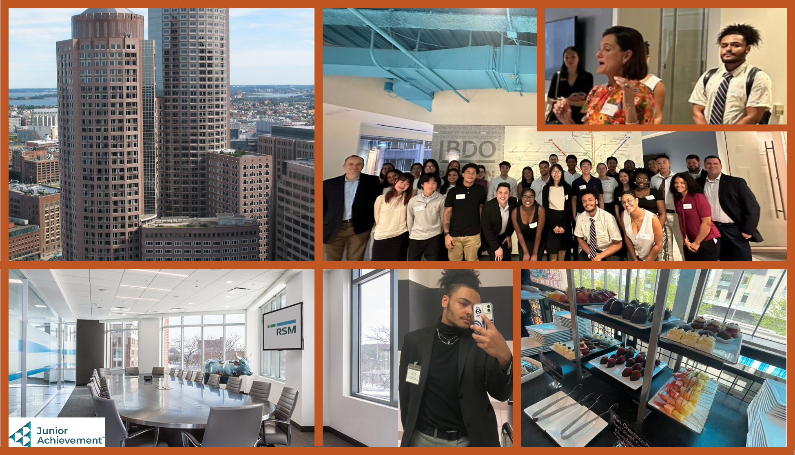
* **Problem:** Scaling youth financial literacy and entrepreneurial programs while mobilizing major capital and corporate engagement nationally.
* **Method:** Leveraged a 6-year JA Ambassadorship to spearhead national initiatives, direct virtual charity panels, and partner with corporate hubs (including the RSM Innovation Center).
* **Metric:** Mobilized **$100,000+ in charitable funding**, earning the **$1,000 Sullivan Award** and the **$82,000 National JA Scholarship**.

### Venture Execution & Sustainable Supply Chain — *La Vue E-Commerce*
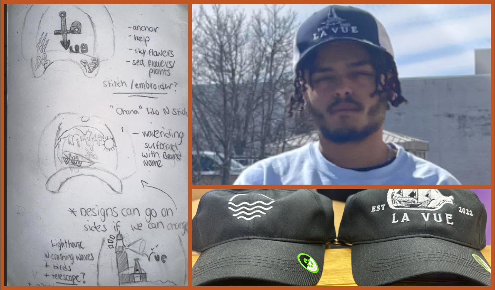
* **Problem:** Sourcing recycled materials aligned with UN Sustainability Goals while driving customer acquisition on a zero-dollar ad budget.
* **Method:** Partnered with *Topiku* (Indonesia) for 100% recycled polyester cap production, set up campus inventory/USPS fulfillment, and ran organic TikTok, Instagram, and campus pop-up sales backed by Shopify and daily pro-forma accounting.
* **Metric:** Capped startup outlay at **$1,841.50** (76-unit break-even at $25 retail), capturing a **42% gross margin** and **39% net margin** while funding *The Ocean Cleanup*.

### Hardware Venture Execution & Global Supply Chain — *TÜB & Revolt Micro-Mobility*
| Revolt Execution | TÜB Execution |
| :---: | :---: |
| 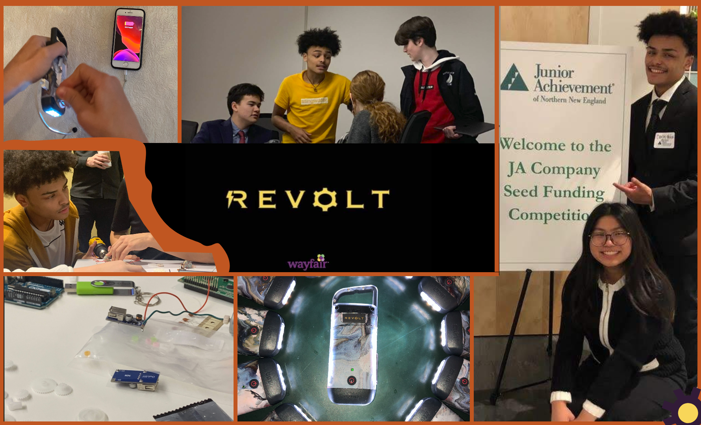 | 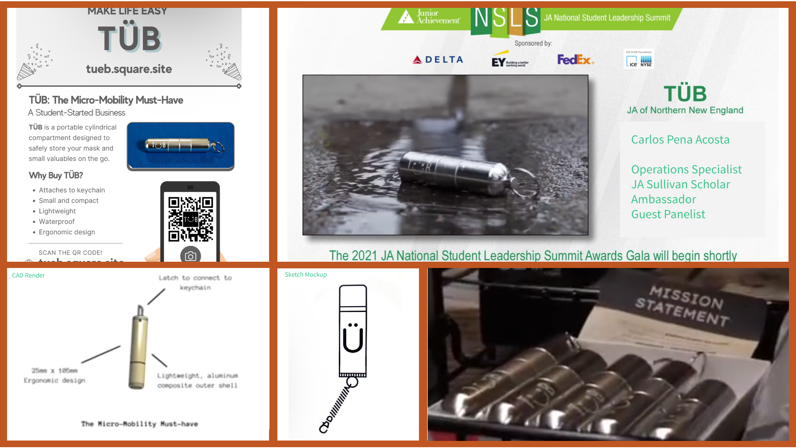 |
* **Problem:** Translating a portable cylindrical micro-mobility concept from bench-level electronics assembly into a scalable, durable manufacturing pipeline under strict sprint deadlines.
* **Method:** Managed hands-on technical assembly (soldering, wiring, CAD, functional testing) in-house while engineering an international supply chain in China to transition from biodegradable prototypes to aluminum-composite shells alongside GTM pitch execution.
* **Metric:** Executed within a **14-week accelerator window**, scaling production and leveraging corporate positioning to help secure **six-figure backing** from partners including Delta, FedEx, EY, and Wayfair.

---

## `b.2_prototyping_hardware/` — Physical Prototyping & Assistive Hardware

### Biomimetic Design & Aerodynamic Prototyping — *Babson Biotech*
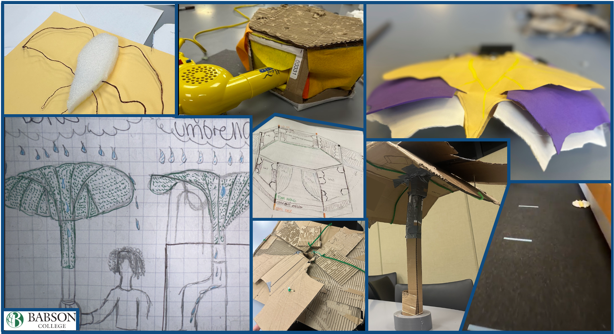
* **Problem:** Translating natural biological structures (bat anatomy and plant growth mechanics) into functional aerodynamic products.
* **Method:** Combined wireframe armatures, layered foam-core/fabric membranes, and thermal molding, followed by empirical flight-path testing.
* **Metric:** Validated aerodynamic stability and structural resilience of nature-inspired geometries under real-world flight conditions.

### Mechanism Design & Spatial Ergonomics — *Olin College of Engineering*
| Human-Scale Spatial Prototyping | Precision Mechanism Fabrication |
| :---: | :---: |
| 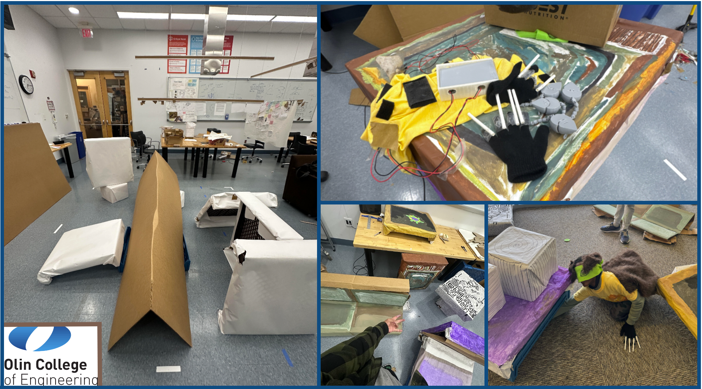 | 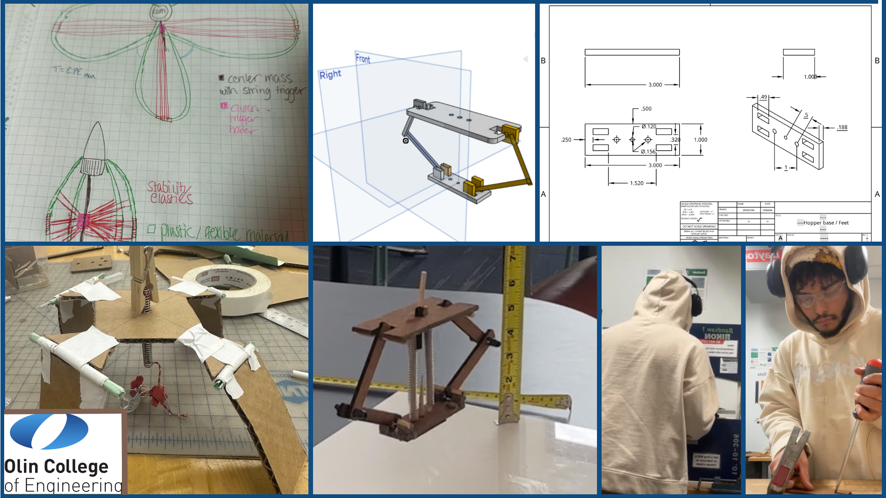 |
* **Problem:** Translating abstract kinetic mechanisms and 2D spatial concepts into load-bearing physical prototypes and ergonomic environments.
* **Method:** Drafted 2D orthographic blueprints and 3D parametric CAD assemblies, machined structural fiberwood components via band saws/benchwork, and built full-scale spatial/wearable prototypes using corrugated cardboard, textiles, and physical computing mounts.
* **Metric:** Delivered tolerance-accurate mechanical assemblies and validated human-scale ergonomics through interactive user-testing installations.

### Assistive Hardware & Interactive Circuitry — *Square Tech / Castle Square Tenants Org*
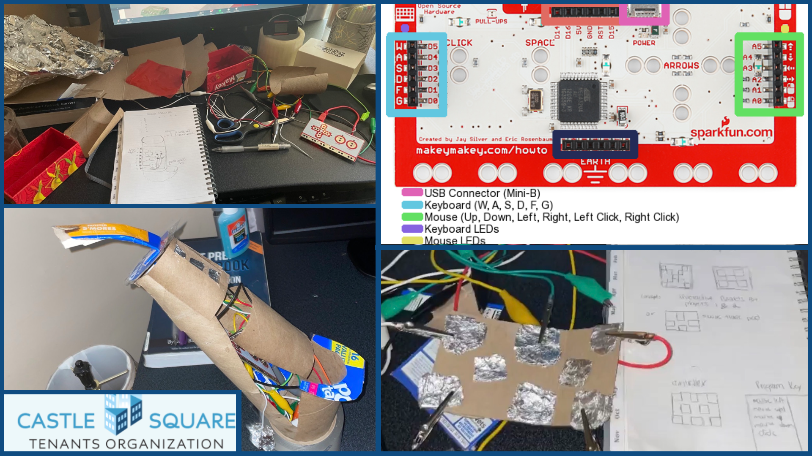
* **Problem:** Bridging tactile physical interfaces with digital triggers while avoiding multi-pin microcontroller routing bottlenecks during rapid builds.
* **Method:** Integrated MaKey MaKey microcontrollers, custom jumper matrices, and wearable textile peripherals using color-coded pin mapping and systematic hardware debugging.
* **Metric:** Eliminated wiring faults across low-voltage interactive builds, producing a functional **3-octave saxophone** and interactive **checkers board game**.

---

## `b.3_systems_pipelines/` — Embedded Diagnostics, Telemetry & Geospatial Systems

### Geospatial Platform Architecture — *BarbershAPP Platform*
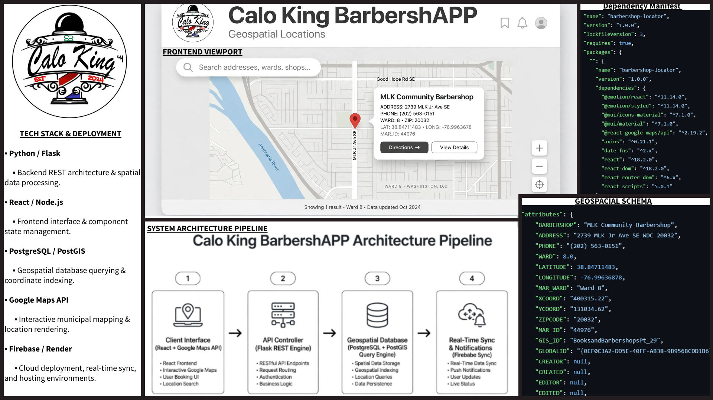
* **Problem:** Municipal spatial and demographic data for small businesses and barbershops in Washington, D.C., is difficult to query intuitively via standard maps.
* **Method:** Built a full-stack Flask and React web app integrated with the Google Maps API, migrating from local PostgreSQL/PostGIS to Render with real-time spatial indexing and JSON attribute caching.
* **Metric:** Deployed a live municipal mapping platform featuring custom ward-level coordinate parsing and interactive state management.

### Embedded Diagnostic Hardware & Clinical Workflows — *IEEE GHTC / Solar Ear Partnership*
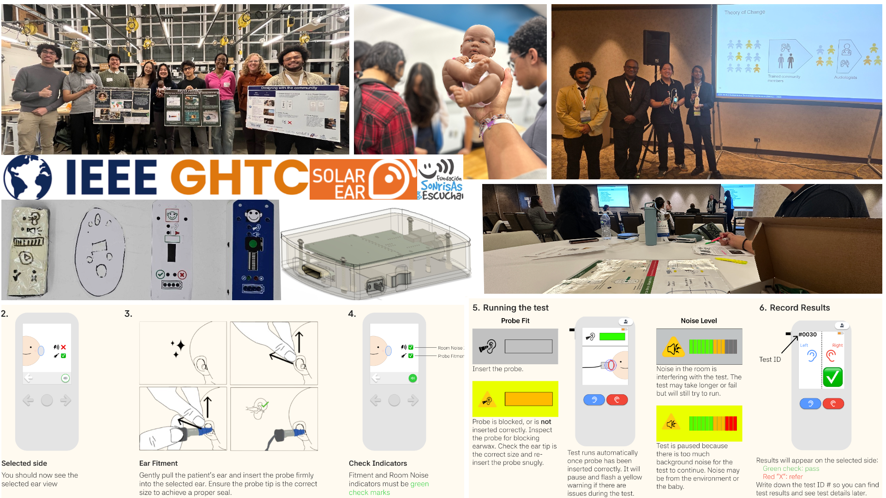
* **Problem:** High commercial costs ($3.5k–$10k) and complex clinical workflows block low-resource clinics from adopting infant Otoacoustic Emission (OAE) hearing screening devices.
* **Method:** Co-designed an STM32-based diagnostic device with custom 3D CAD ear-probe shells, a guided mobile UI for probe fitment/noise thresholds, and international clinical workflows with Solar Ear x Guatemala.
* **Metric:** Presented at **IEEE GHTC**, field-tested in international clinics, reduced target hardware manufacturing costs by **>60%**, and compiled cross-project IEEE correlation matrices for open-source integration.

### Embedded Systems & Telemetry Parsing — *Soft Sys C-Struct Architecture*
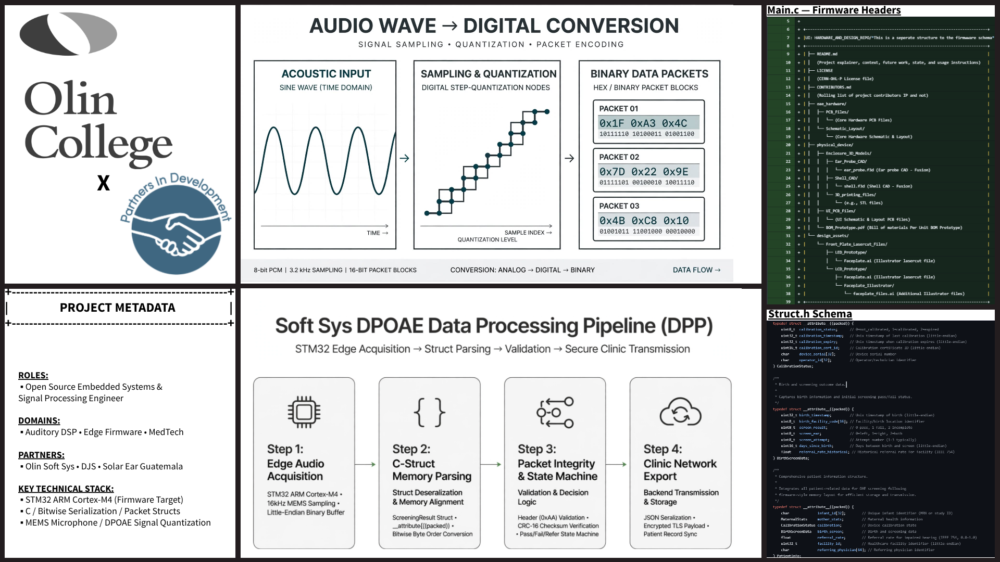
* **Problem:** Raw edge audio samples and diagnostic metrics lack structured transport schemas, causing memory corruption and parsing bottlenecks during backend transmission.
* **Method:** Engineered a packed C-struct systems parser (`__attribute__((packed))`) utilizing bitwise byte-order conversion, little-endian buffering, and CRC-16 packet integrity validation.
* **Metric:** Established an ultra-low-latency edge-to-cloud telemetry pipeline with **100% checksum verification**.

---

## `b.4_foray_gtm_playbooks/` — Plant Tissue Culture & Commercial GTM Playbooks

### Wet-Lab Assay Validation & Commercial GTM Playbook — *Foray*
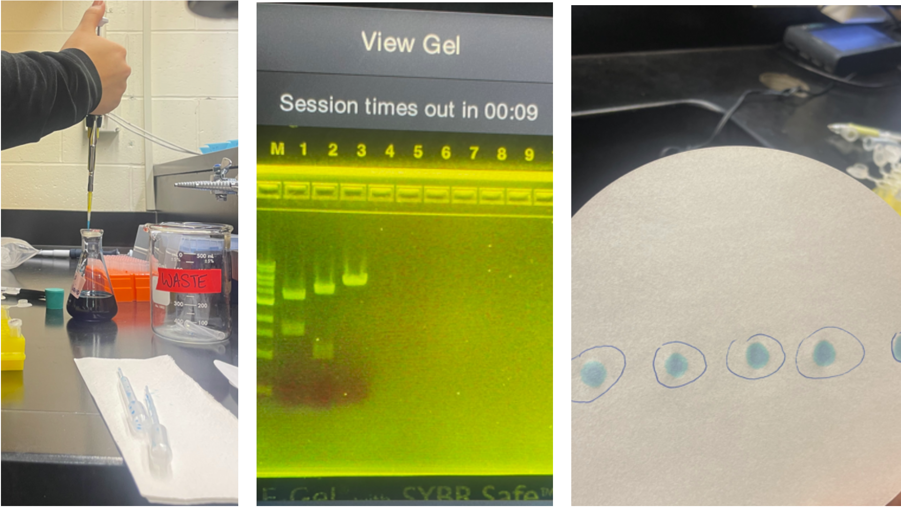

* **Left:** Precision micropipetting for tissue culture reagent dosing.
* **Center:** Agarose gel electrophoresis output (SYBR Safe DNA fragment analysis).
* **Right:** Serial dilution validation on filter media.

* **Problem:** Translating reproducible plant tissue culture workflows into scalable market adoption across academic, greenhouse, and research ecosystems without standardized outreach playbooks.
* **Method:** Paired wet-lab assay validation (reagent dosing, SYBR Safe gel fragment verification, and serial dilution protocols) with primary market surveys across **50+ institutions**  in the Greater Boston area, culminating in a formal GTM playbook presentation including data base tutorial and brand avatars to Foray leadership.
* **Metric:**  Mapped **50+ Greater Boston institutions** prospects, delivering an actionable multi-channel GTM playbook targeting greenhouse culture hubs, industry conferences, community events, and curriculum induction pipelines.

| Foray Playbook I | Foray Playbook II | Foray Playbook III |
| :---: | :---: | :---: |
| 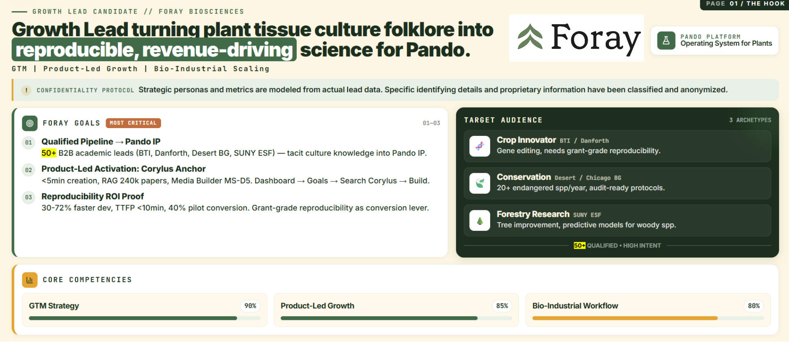 | 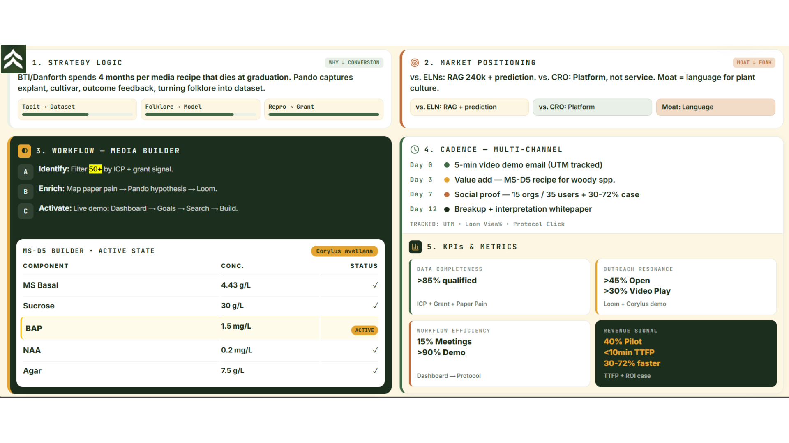 | 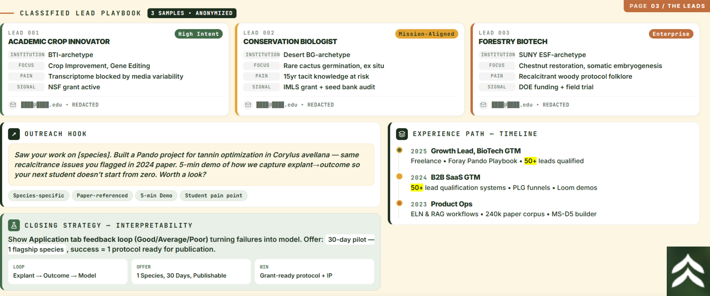 |
