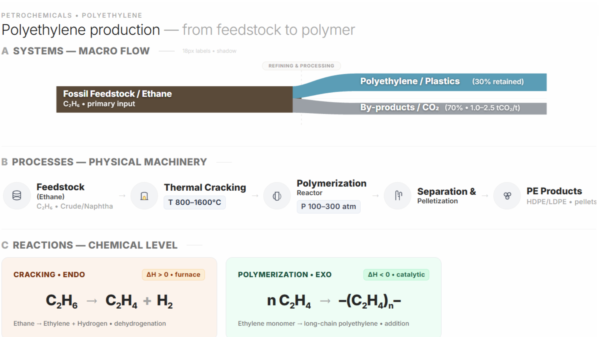
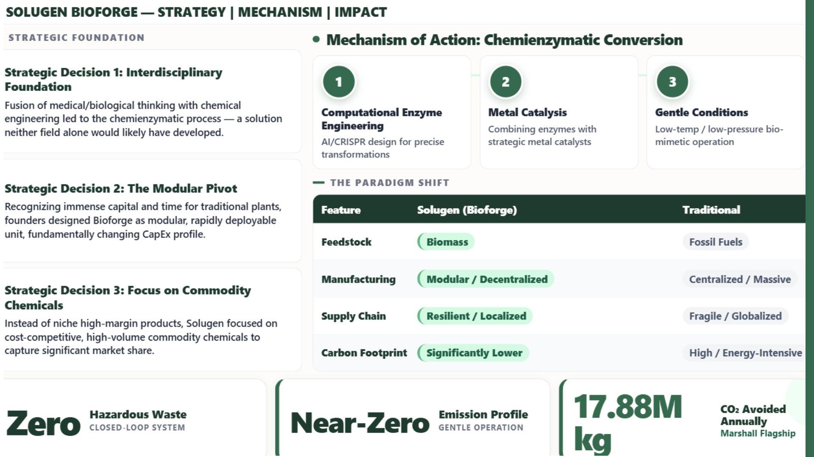
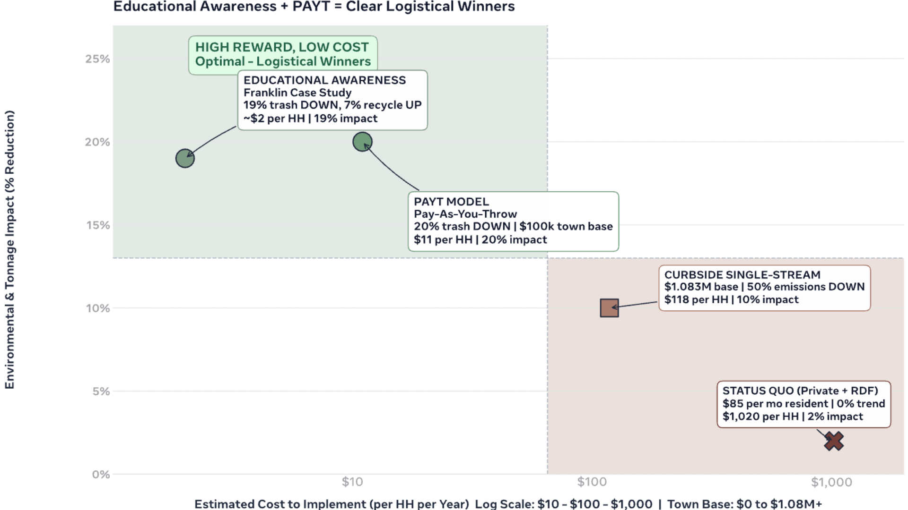
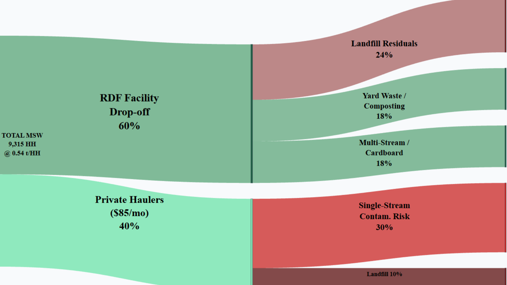
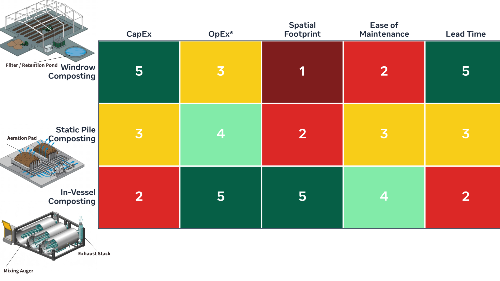
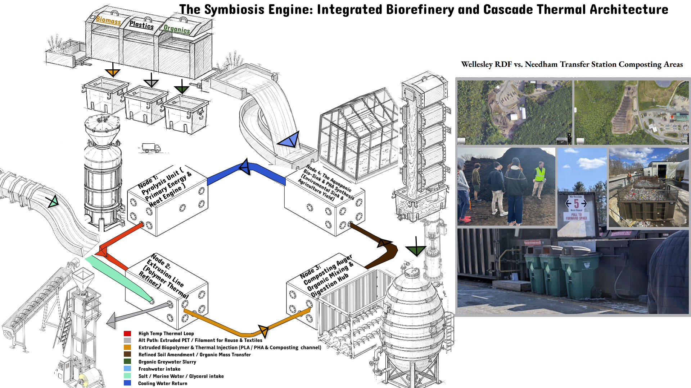

# Module C: Circular Economy & Industrial Symbiosis

Chemo-enzymatic biomanufacturing, municipal solid waste logistics, and closed-loop resource recovery architectures.

---

## `c.1_solugen_chemo_enzymatic/` — Solugen Bioforge & Chemical Innovation

| Closed-Loop Biomanufacturing Platform | Macro-Flow & Feedstock Architecture | Chemo-Enzymatic Mechanism & Metrics |
| :---: | :---: | :---: |
|  |  |  |

* **Problem:** Traditional petrochemical manufacturing relies on linear, capital-intensive, high-emission thermal cracking.
* **Method:** Modeled a modular bioforge platform utilizing CRISPR/AI enzyme optimization and metal catalysts to drive continuous-flow chemical production under ambient, low-temperature conditions.
* **Metric:** Achieved a near-zero emission profile, **zero hazardous waste**, and **17.88M kg of CO₂ avoided annually** at the Marshall flagship facility.

---

## `c.2_sirc_municipal_logistics/` — SIRC Municipal Infrastructure & Logistics

| Cost-Benefit Scatter Analysis | Wellesley MSW Sankey Flow | Multi-Criteria Decision Matrix (MCDM) |
| :---: | :---: | :---: |
|  |  |  |

* **Problem:** Municipal waste management is constrained by high-CapEx processing plants, single-stream recycling contamination, and a lack of decentralized diversion strategies.
* **Method:** Evaluated industrial composting via a heat-mapped Multi-Criteria Decision Matrix (MCDM) and mapped Wellesley's municipal solid waste (MSW) streams using a logistical Sankey flow model.
* **Metric:** Identified high-efficiency intervention points (PAYT and decentralized in-vessel composting) capable of **reducing trash tonnage by up to 20%** at minimal household cost.

---

## `c.3_symbiosis_engine_master/` — Closed-Loop Resource Recovery Systems

* **Problem:** Disconnected municipal waste streams and high-temperature thermal loops fail to capture full chemical and biological resource value.
* **Method:** Designed an integrated 4-node closed-loop system combining a **Pyrolysis Unit (Node 1)**, **Extrusion Line (Node 2)**, **Composting Auger (Node 3)**, and **Aquaponic Bio-Sink / PHA Synthesis (Node 4)** paired with Wellesley RDF field verification.
* **Metric:** Diverts **30–46% of landfill-bound waste** into refined soil amendments, energy sources, and biodegradable polyhydroxyalkanoates (PHAs) via localized modular infrastructure.
